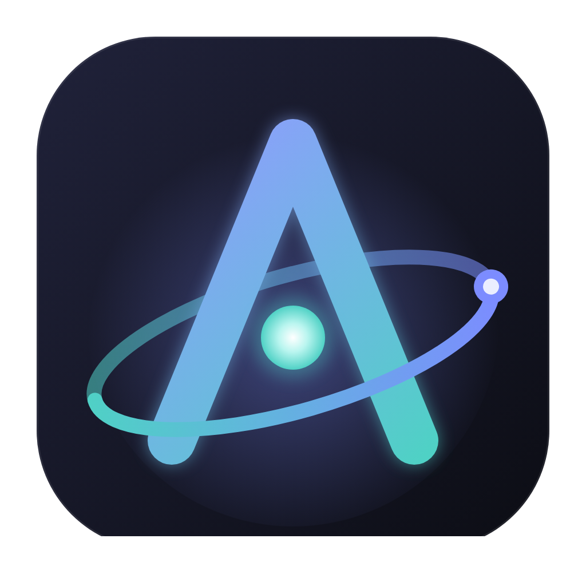

<div align="center">
  
  <h1>ATOM Code</h1>
  <p><b>Claude destekli, yapay zekâ öncelikli kod editörü.</b><br/>Cursor tarzı bir arayüz + Claude Code'un ajan altyapısı (harness), kendi Claude aboneliğinizle.</p>
</div>

---

## Türkçe

### Nedir?

ATOM Code; Monaco editörü, dosya gezgini, arama, Git paneli ve entegre terminaliyle tam bir masaüstü kod editörüdür. Sağ taraftaki **ATOM ajanı**, Anthropic'in resmi **Claude Agent SDK**'sı (kütüphane olarak paketlenmiş Claude Code) ile çalışır. Bu sayede Claude Code'un tüm harness'ını devralır: yerleşik araçlar (Read, Edit, Write, Bash, Grep, Glob, WebSearch, WebFetch), izin sistemi, alt-ajanlar, skill'ler, slash komutları, oturum geçmişi, dosya kontrol noktaları (checkpoint) ve bağlam yönetimi.

### Öne çıkan özellikler

- **Claude aboneliğiyle giriş** — Pro / Max / Team planınızla, resmi Claude Code girişini kullanarak (tarayıcıda onay). Alternatif olarak uzun ömürlü token veya Anthropic API anahtarı.
- **Ajan modları** — `Agent` (uçtan uca kodlama), `Plan` (salt-okunur araştırma + onaylı plan), `Ask` (kodu değiştirmeden soru-cevap), `Debug` (sistematik kök neden analizi), `Review` (değişiklik incelemesi), `TDD` (önce test). Kendi modlarınızı ayarlardan oluşturabilirsiniz. Composer'da `Shift+Tab` ile modlar arasında geçiş.
- **İzin politikaları** — *Değişikliklerden önce sor*, *Düzenlemeleri otomatik kabul et*, *Otomatik (akıllı sınıflandırıcı)*, *Tam otomatik (YOLO)*. Her araç çağrısı için satır içi onay kartı: bir kez izin ver, bu sohbet için izin ver, her zaman izin ver, reddet + geri bildirim.
- **Canlı sohbet** — akış halinde metin, düşünme blokları, zengin araç kartları (diff önizlemeli düzenlemeler, terminal çıktılı Bash, dosya listeli Grep/Glob, iç içe alt-ajan görevleri), canlı yapılacaklar (todo) şeridi, plan onay kartı, çoktan seçmeli soru kartı, tur özeti (süre, tur, token, ≈maliyet), bağlam doluluk halkası.
- **Bağlam ekleme** — `@` ile dosya/klasör/seçim/terminal/problemler/git diff; görsel yapıştırma; aktif dosya otomatik bildirilir. Editörde `⌘L` seçimi sohbete ekler.
- **Satır içi düzenleme (`⌘K`)** — seçili kodu doğal dille dönüştür, diff olarak önizle, kabul et/reddet.
- **Kontrol noktaları** — her kullanıcı mesajından önceki dosya durumuna geri dönme.
- **Yerleşik skill kütüphanesi** — 17 uzman skill, 8 alt-ajan, 12 slash komutu (aşağıda). Kendi skill'lerinizi Skills panelinden oluşturun.
- **IDE araçları (MCP)** — ajan; açık editörleri, seçiminizi, derleyici/linter hatalarını ve terminal çıktısını görebilir, size bir dosyayı açıp gösterebilir.
- **Tam editör** — Monaco (çoklu sekme, diff görünümü, mini harita), dosya gezgini (sürükle-bırak, git renkleri), ripgrep tabanlı arama, Git paneli (stage/commit/push, ✨ commit mesajı üretimi), çoklu terminal (node-pty), komut paleti (`⌘⇧P`), hızlı dosya açma (`⌘P`), 3 tema (Dark, Midnight, Light).
- **Oturum geçmişi** — eski sohbetleri arayın, yeniden adlandırın, kaldığınız yerden devam edin.
- **MCP sunucuları** — ayarlardan stdio/http/sse sunucuları ekleyin; projedeki `.mcp.json` otomatik yüklenir.

### Kurulum

Gereksinimler: **Node.js 20+**, **npm**, **git**.

```bash
git clone https://github.com/omerfarukbilen/atom-code.git
cd atom-code
npm install
npm run dev          # geliştirme modunda başlat
```

Paketleme:

```bash
npm run dist:mac     # .dmg / .zip
npm run dist:win     # NSIS kurulum
npm run dist:linux   # AppImage / .deb
```

> Claude Code ikili dosyası Agent SDK ile birlikte gelir (`@anthropic-ai/claude-agent-sdk-<platform>`); ayrıca kurmanız gerekmez.

### Claude aboneliğinizle giriş

1. ATOM Code'u açın → sağdaki ajan panelinde **Sign in with Claude**'a tıklayın.
2. Açılan pencerede resmi Claude Code girişi (`claude auth login --claudeai`) çalışır; tarayıcınızda Claude hesabınızla onay verin. İstenirse gösterilen kodu pencereye yapıştırın.
3. Giriş tamamlanınca planınız (Pro/Max) ve e-postanız durum çubuğunda görünür.

Alternatifler: **Uzun ömürlü token** (`claude setup-token`, ATOM Code bunu şifreli saklar) veya **API anahtarı** (Ayarlar → Account). Kimlik bilgileri Electron `safeStorage` ile işletim sisteminin anahtar zincirinde şifrelenir.

> **Not:** Abonelik girişi, ATOM Code'u **kendi kişisel kullanımınız** içindir. ATOM Code'u başkalarına dağıtacaksanız Anthropic'in kullanım koşulları gereği API anahtarı ile kimlik doğrulama kullanın.

### Klavye kısayolları

| Kısayol | İşlev |
|---|---|
| `⌘P` / `Ctrl+P` | Dosyaya git |
| `⌘⇧P` | Komut paleti |
| `⌘L` | Ajan paneline odaklan / seçimi sohbete ekle |
| `⌘⇧L` | Yeni sohbet |
| `⌘K` (editörde) | Satır içi AI düzenleme |
| `Shift+Tab` (composer) | Ajan modunu değiştir |
| `⌘.` / `⌘/` | Mod / model seçici |
| `⌘B` / `⌘J` / `⌘⌥B` | Kenar çubuğu / alt panel / ajan paneli |
| `` Ctrl+` `` | Terminal |
| `⌘S` / `⌘⌥S` | Kaydet / tümünü kaydet |
| `⌘,` | Ayarlar |

### Proje kuralları

Proje köküne bir **`ATOM.md`** dosyası koyun (Ayarlar → Rules → *Create ATOM.md*): ajan her sohbette bu kuralları okur. `CLAUDE.md` dosyaları da otomatik yüklenir. Genel talimatlar için Ayarlar → Rules → *Custom instructions*.

---

## English

ATOM Code is a Cursor-style desktop code editor whose agent runs on the official **Claude Agent SDK**, so it inherits Claude Code's harness — built-in tools, permissions, hooks, subagents, skills, slash commands, sessions, file checkpoints and context management — and signs in with your **Claude subscription** through the official Claude Code login.

### Highlights

- Sign in with Claude (Pro/Max/Team) via the official `claude auth login`, or use a long-lived token / API key (stored encrypted with `safeStorage`).
- **Agent modes**: Agent, Plan, Ask, Debug, Review, TDD + custom modes. **Permission policies**: ask, auto-accept edits, auto (classifier), full auto.
- Rich live transcript: streaming text and thinking, tool cards with inline diffs and terminal output, nested subagent tasks, todo strip, plan approval, multiple-choice questions, turn stats, context ring.
- `@` context (files, folders, selection, terminal, problems, git diff), image paste, `⌘K` inline edit, `⌘L` add selection to chat, checkpoints/rewind.
- Bundled skills library (17 skills, 8 subagents, 12 commands) + your own skills from `~/.claude/skills` and `.claude/skills`.
- In-process **atom-ide** MCP server: the agent can read open editors, your selection, diagnostics and terminal output, and open files for you.
- Full editor: Monaco, explorer, ripgrep search, Git panel with AI commit messages, node-pty terminals, command palette, quick open, three themes.

### Bundled skills, subagents and commands

| Skills (`atom:*`) | |
|---|---|
| systematic-debugging · test-driven-development · code-review · writing-plans · executing-plans · refactoring | core engineering workflows |
| git-workflow · frontend-design · api-design · security-audit · performance-optimization · documentation | craft |
| project-onboarding · dependency-upgrades · database-migrations · error-handling · writing-skills | project work |

**Subagents:** code-reviewer, debugger, test-engineer, architect, security-auditor, docs-writer, refactorer, explorer.
**Commands:** `/atom:review`, `/atom:test`, `/atom:commit`, `/atom:explain`, `/atom:fix`, `/atom:plan`, `/atom:init`, `/atom:pr`, `/atom:refactor`, `/atom:docs`, `/atom:optimize`, `/atom:security`.

### Development

```bash
npm run dev            # electron-vite dev server + Electron
npm run typecheck      # main + renderer
npm test               # unit tests (node:test)
npm run build          # production build into out/
node scripts/check-plugin.mjs   # validate the bundled plugin (no model calls)
ATOM_FAKE_AGENT=1 npm run dev   # scripted agent for UI work — no sign-in, no API calls
```

Architecture, process model and module specs: [docs/ARCHITECTURE.md](docs/ARCHITECTURE.md).

### License

MIT © Ömer Faruk Bilen. Claude, Claude Code and the Claude Agent SDK are products of Anthropic; their use is subject to Anthropic's terms.
